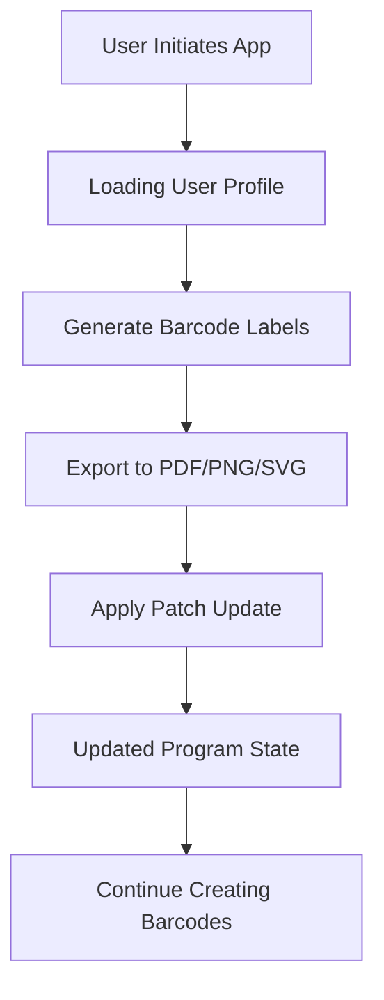

# 🦂 Scorpion BarCode for Mac Free Download

Welcome to the comprehensive, community-powered repository for **Scorpion BarCode for Mac Free Download**! If you’ve ever wished to unlock the potential of streamlined label designing and barcode generation on macOS, you’re in the right place. This is your all-in-one resource for **barcode maker Mac**, **barcode generator macOS**, and **free barcode software for Mac** needs.

---

## 🚀 Table of Contents

- Overview
- Features
- macOS Compatibility & System Requirements
- Example Profile Configuration
- Example Console Invocation
- Mermaid Diagram
- Installation & Download
- Multilingual & Responsive User Experience
- 24/7 Customer Support
- Disclaimer
- License

---

## 🎨 Overview

**Scorpion BarCode for Mac** brings professional-grade barcode label creation to your desktop with a beautiful, modern interface designed for macOS. Save time, eliminate errors, and boost your efficiency with our free barcode generator tailored for Apple environments. Engage in projects with confidence—whether you’re managing inventory, retail, publishing, or logistics, Scorpion BarCode is your digital Swiss army knife for barcode management.

---

## ✨ Features

- **Intuitive, Responsive UI:** Leverages macOS design principles to deliver a frictionless experience. Instant previews, drag-and-drop organization, and blazing-fast barcode rendering—your workflow, turbocharged.
- **Multilingual Support:** Communicate with the world—Chinese, Spanish, French, and many more.
- **24/7 Customer Support:** Our digital lifeguards are always on duty, ready to save your day (or night) whenever you need help.
- **Patch-ready Design:** Seamlessly apply updates or patches without pausing your productivity.
- **Batch Barcode Creation:** Generate hundreds of unique labels with just a few clicks.
- **Export Formats:** PDF, PNG, SVG, and EPS—share your codes your way.
- **Extensive Barcode Library:** All major standards at your fingertips—UPC, EAN, ISBN, QR Code, Code 128, Code 39, DataMatrix, and more.
- **macOS Utility Integration:** AppleScript and Automator compatible.
- **Accessibility Features:** For every user—voice-over compatibility, high-contrast modes, and more.

---

## 🍏 macOS Compatibility Chart & System Requirements

**Looking for the right fit?** Check our ever-evolving compatibility matrix:

| macOS Version         | Supported | Minimum RAM | Processor          |
|-----------------------|:---------:|:-----------:|-------------------|
| macOS 14 Sonoma       | ✅        | 4GB         | Apple Silicon / Intel x64 |
| macOS 13 Ventura      | 👍        | 4GB         | Apple Silicon / Intel x64 |
| macOS 12 Monterey     | 👍        | 4GB         | Apple Silicon / Intel x64 |
| macOS 11 Big Sur      | ✅        | 4GB         | Apple Silicon / Intel x64 |
| macOS 10.15 Catalina  | ✅        | 4GB         | Intel x64          |
| macOS 10.14 Mojave    | ⚠️        | 4GB         | Intel x64          |

> **Tip:** Scorpion BarCode sings best on macOS 11 Big Sur or newer with native Apple Silicon support.

---

## 🛠 Example Profile Configuration

YAML markup for a typical project profile:

    barcode_format: "Code_128"
    output_format: "PDF"
    label_size: "2x1_inch"
    content_source: "CSV"
    auto_increment: true
    batch_size: 500
    language: "en"
    dark_mode: true
    customer_support: "24/7"

---

## 💻 Example Console Invocation

Run Scorpion BarCode tools manually from the terminal for scriptable automation:

    $ /Applications/ScorpionBarCode.app/Contents/MacOS/ScorpionBarCode \
        --format Code_128 \
        --input items.csv \
        --output labels_batch.pdf \
        --lang es \
        --batch 200

---

## 📈 Mermaid Diagram

A quick map showing how patch updates fit into the workflow:

---

## 🌍 Multilingual & Responsive User Experience

Scorpion BarCode is built from the ground up to be both a polyglot and a chameleon. The UI responds instantly and elegantly to changes—language, theme, accessibility needs, or workflow tweaks. Whether your team is in Toronto, Tokyo, or Turin, you’ll feel right at home.

---

## 👨‍💻 Installation & Download

**Getting started is smoother than silk.**

1. Ensure your Mac meets our requirements (see above).
2. Download the latest free version here:

   

3. Open the `.dmg` file and drag Scorpion BarCode into your `Applications` folder.
4. Launch the app and start creating!

---

## 🤝 24/7 Customer Support

Questions at midnight? Bug at breakfast? Our support team spans time zones, so help is never more than a click away, regardless of the clock.

---

## ⚠️ Disclaimer

This repository is for informational purposes only and does not distribute commercial licenses or proprietary software. **Scorpion BarCode for Mac Free Download** is provided "as is". Download links and resources provided herein are for evaluation, educational, or personal use. Please review the terms and conditions of use as provided by the official developers of Scorpion BarCode.

---

## 📜 License

Distributed under the [MIT License](https://opensource.org/licenses/MIT).  
&copy; 2026 Scorpion BarCode for Mac Free Download Community.

---

## 🏁 Get Scorpion BarCode for Mac Now

To supercharge your labeling workflow, download the latest version today:

---

**Made with ❤️ for Mac users everywhere. Let's digitize together!**